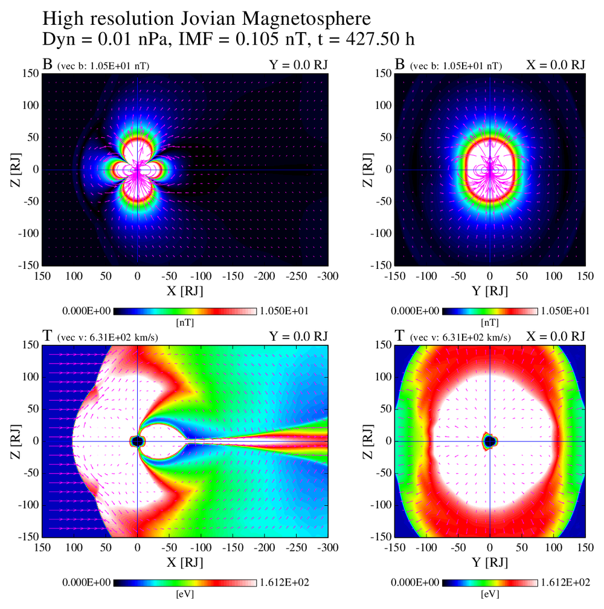
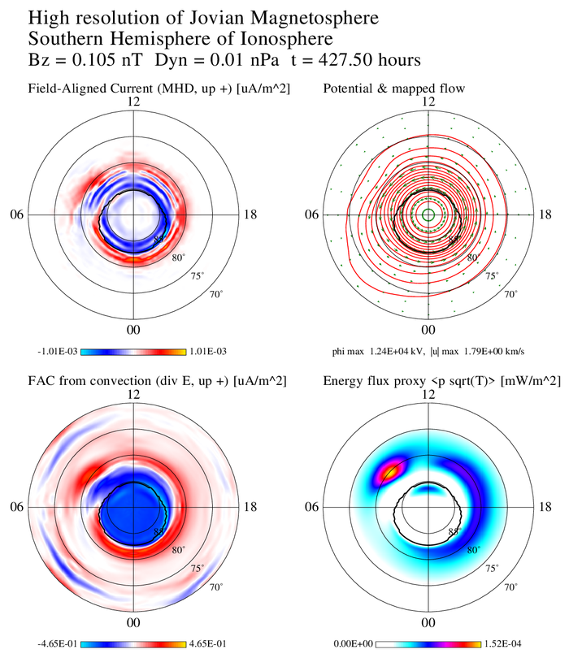
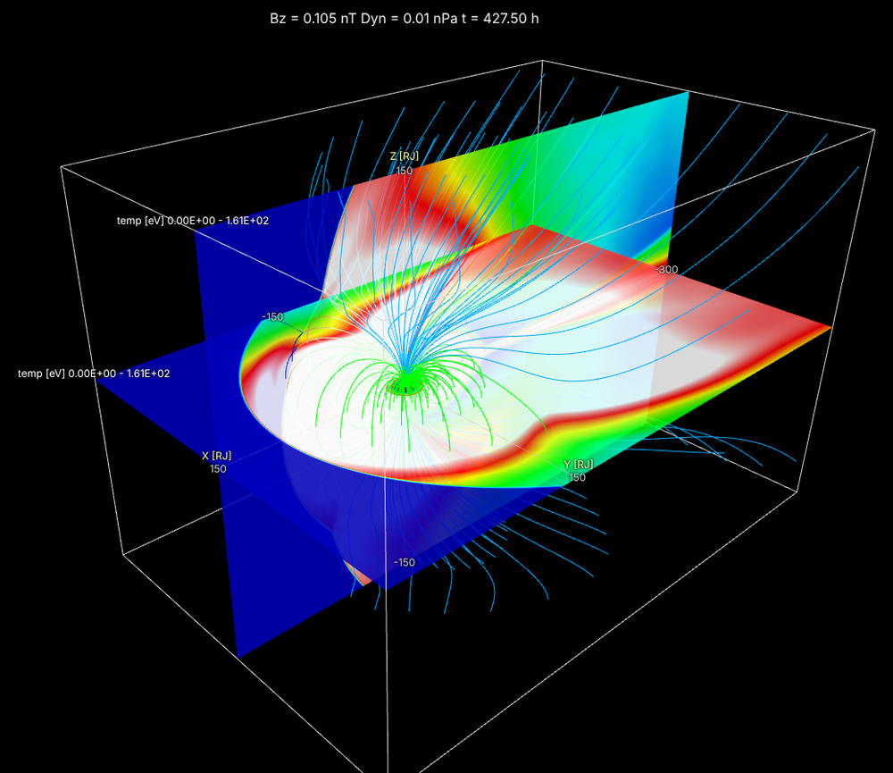

# MHD viztools Fortran — 惑星磁気圏 MHD シミュレーションの可視化ツール

[English](README.md)

[](https://doi.org/10.5281/zenodo.24030429)

惑星磁気圏のグローバル MHD シミュレーションの出力を、結合・解析・可視化するための Fortran ツール群です。
**故 荻野瀧樹教授が開発・使用してきた磁気圏 MHD コードの可視化ツール (断面図・極域図・VRML による 3 次元表示など) を、
現在の計算機環境で使いやすいようにモダン化したもの**です。木星版コード (jupiter7) の出力で開発・検証していますが、
同じ出力形式であれば土星・地球などの計算にも使えます。

## 特徴

* Fortran 2008 + OpenMP。外部ライブラリは HDF5 出力時のみ必要
* 設定はすべて namelist で与える (格子サイズ・ファイル・描く量や断面を変えても再コンパイル不要)
* 巨大なデータ (標準 3002×2002×1002 格子 × 8 変数, 約 190 GB) でも、必要な面・行・変数だけを直接読むので
  メモリは数 GB 程度
* 規格化された量を物理単位 (cm⁻³, km/s, nPa, nT, eV, µA/m², kV など) に戻して表示・出力する。
  木星・土星・地球の規格化定数を内蔵し、距離の単位 (RJ / RS / RE) も切り替わる
* 派生量 (温度 p/ρ など)・単位換算・差分は倍精度で計算
* 3 次元表示は glTF 2.0 (.glb) と X3D で出力し、ブラウザ (付属の viewer.html)・Blender・ParaView で見られる

## ツール

| ツール | 内容 |
|---|---|
| `combine3d` | MPI ランク毎の出力を 1 つの 3 次元データ (`m.data`) に結合 |
| `vorticity` | 渦度の磁場平行・垂直成分 |
| `bin2hdf` | ParaView / Python 用の HDF5 + XDMF (または生バイナリ + XDMF) に変換 |
| `slice_plot` | 任意の断面 (xy / xz / yz, 位置指定) のカラー図 + ベクトル (PostScript) |
| `polar_map` | 極域電離圏への写像: 沿磁力線電流・対流と電位・開閉境界・エネルギーフラックス |
| `mag3d` | 3 次元可視化: 磁力線 (惑星に繋がる線・太陽風・ループ)・断面・多重断面・選択断面・等値面・矢印・惑星の画像・カラーバー |

元のツールの出力形式 (`m.data`, `.vort`, `.h5`/`.xmf`) はそのまま保っているので、既存のデータや解析スクリプトも使えます。
元のツールで見つかった問題点 (極域図の写像・電位計算など) とその修正内容は [利用者マニュアル](doc/manual_ja.md) に書いてあります。

### 例 (木星の計算)

| `slice_plot` | `polar_map` |
|---|---|
|  |  |
| 子午面 (左) と朝夕面 (右) の磁場強度 (上) と温度 (下)、磁場・速度ベクトル付き | 南半球の極域電離圏: 沿磁力線電流、対流電位と写像した流れ、対流から求めた沿磁力線電流、エネルギーフラックスの目安と開閉境界 |

`mag3d` (`viewer/viewer.html` で表示): 赤道面と子午面の温度、惑星に繋がる磁力線と繋がらない磁力線



## 必要なもの

* Fortran コンパイラ: gfortran, Intel ifx/ifort, NEC nfort, Fujitsu frtpx, NVIDIA nvfortran (Makefile で選択)
* OpenMP (無しでもビルド可)
* HDF5 (Fortran ライブラリ, `bin2hdf` で HDF5 を書くときだけ)
* 図の変換に ghostscript (`scripts/ps2png.sh`)、テストに python3 + numpy

## 使い方

```sh
make                          # gfortran + OpenMP。Intel なら make COMPILER=intel
make test                     # 回帰テスト (合成データ・解析解との比較)

cp namelist/ja/mag3d.nml .    # 設定例を写して、ファイル名・格子・描く内容を書き換える
OMP_NUM_THREADS=16 ./bin/mag3d mag3d.nml         # -> .glb
```

* 各ツールは `./bin/<ツール名> <namelist ファイル>` で実行します。設定例は `namelist/` (日本語コメント版は `namelist/ja/`) にあります
* バッチジョブの例 (Slurm): `scripts/ja/job_example.sh` (英語版 `scripts/job_example.sh`)
* PostScript の図は `scripts/ps2png.sh file.ps [pdf]` で PNG / PDF に変換
* 3 次元表示: `viewer/viewer.html` をブラウザで開き、.glb を選ぶかドラッグ & ドロップ
  (層の表示切替、断面の不透明度、選択断面のスライダー、視点、カラーバー、PNG 保存)

物理単位と惑星の指定 (各 namelist ファイルの `&units` グループ):

```
&units
  planet = 'jupiter',          ! 'jupiter' / 'saturn' / 'earth' / 'custom'
  temp_unit = 'eV'
/
```

詳しくは [利用者マニュアル](doc/manual_ja.md) を参照してください (英語版 [doc/manual_en.md](doc/manual_en.md))。

## ディレクトリ

ソースコードのコメント・ビューアの表示・テストの出力は英語です。

```
src/        Fortran ソース
namelist/   各ツールの設定例 (namelist/ja/ は日本語コメント版)
viewer/     glTF ビューア (three.js), X3D / VRML ビューア (X_ITE)
textures/   惑星の画像 (地球: Natural Earth, 木星・土星: 模式図)
scripts/    PostScript 変換, バッチジョブの例
test/       回帰テスト
doc/        利用者マニュアル (manual_ja.md, 英語版 manual_en.md)
```

## 経緯と謝辞

これらの可視化ツールの基本部分は、名古屋大学 荻野瀧樹教授が開発し、Web で公開していたものです。
荻野教授の指導を受けた深沢が、その後に加えてきた改良・追加開発部分 (これまで未公開) とあわせ、
現在の計算機環境向けにモダン化して公開します。基本を築かれた荻野教授の功績に深く感謝します。

* 元の可視化ツール:  荻野瀧樹
* 改良・追加開発・モダン化: 深沢圭一郎 (Keiichiro FUKAZAWA, 総合地球環境学研究所, ORCID [0000-0002-4862-6411](https://orcid.org/0000-0002-4862-6411))
* 地球の画像: Natural Earth (パブリックドメイン, https://www.naturalearthdata.com/)
* 木星・土星の画像は帯構造を模した模式図 (`textures/make_textures.py` で生成)。実際の画像に替えるときは
  同じ名前の正距円筒図法の画像で置き換えてください
* ビューア: three.js (MIT License), X_ITE (MIT License) を CDN から読み込みます

## 引用

研究で使った場合は、[CITATION.cff](CITATION.cff) の情報 (Zenodo DOI: [10.5281/zenodo.24030429](https://doi.org/10.5281/zenodo.24030429)) で引用してください:

> Ogino, T., & FUKAZAWA, K. (2026). MHD viztools Fortran: visualization tools for planetary magnetosphere MHD simulations (Version 1.0.0) [Computer software]. Zenodo. https://doi.org/10.5281/zenodo.24030429

## ライセンス

[MIT License](LICENSE)
